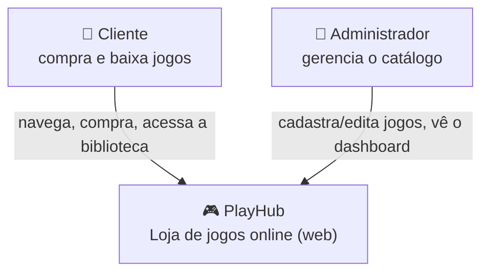
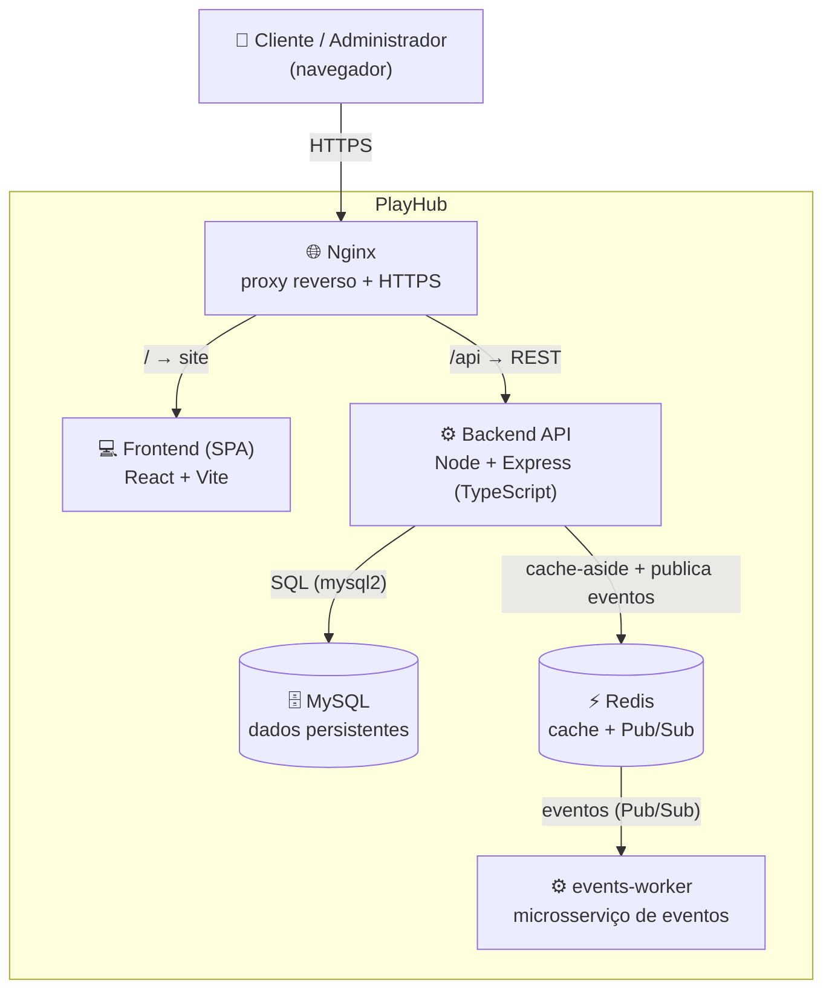

# Diagramas C4 — PlayHub (keys-forge)

O modelo C4 descreve a arquitetura em níveis. Aqui estão os dois níveis
iniciais: **Contexto** (nível 1) e **Containers** (nível 2).

---

## Nível 1 — Contexto do sistema

Mostra quem usa o PlayHub e para quê, sem detalhar a parte interna.

**Atores**

- **Cliente:** cria conta, faz login, navega no catálogo, compra jogos e acessa
  sua biblioteca e lista de desejos.
- **Administrador:** gerencia o catálogo (criar/editar/excluir jogos) e
  acompanha indicadores no dashboard.

---

## Nível 2 — Containers

Abre o PlayHub e mostra as peças que o compõem e como conversam entre si.

**Containers**

| Container | Tecnologia | Responsabilidade |
|---|---|---|
| **Nginx** | nginx | Proxy reverso: encerra HTTPS e roteia `/` para o site e `/api` para a API |
| **Frontend (SPA)** | React + Vite | Interface do usuário (loja, carrinho, biblioteca, dashboard) |
| **Backend API** | Node + Express | Regras de negócio, autenticação JWT, CRUD, compras |
| **MySQL** | MySQL 8 | Guarda usuários, jogos e compras |
| **Redis** | Redis 7 | Cache (cache-aside com TTL) e mensageria (Pub/Sub de eventos) |
| **events-worker** | Node (microsserviço) | Consome os eventos do Redis de forma independente (ex.: notificações) |

Tudo é orquestrado com **Docker Compose**. O Nginx é o único ponto exposto;
backend, banco, Redis e o `events-worker` ficam na rede interna.

> Observação: os diagramas estão em Mermaid, então o GitHub e o VS Code
> (com a extensão Mermaid) renderizam as imagens automaticamente.
