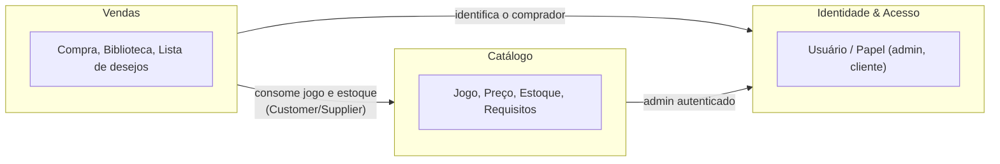
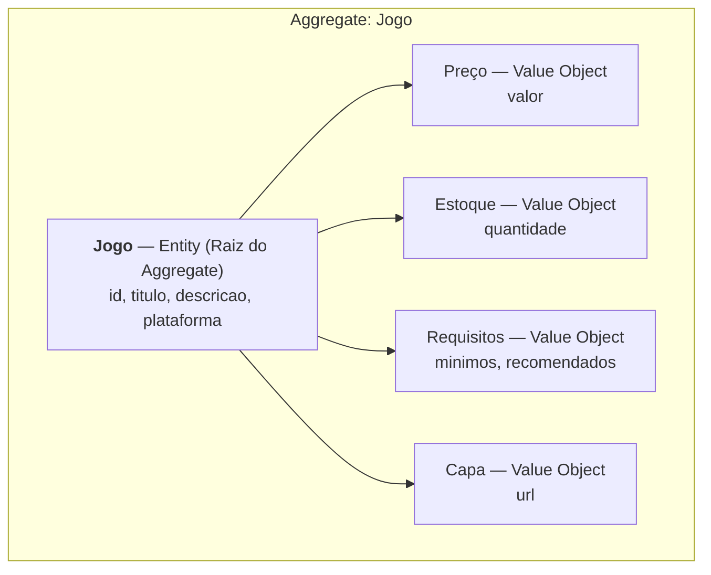
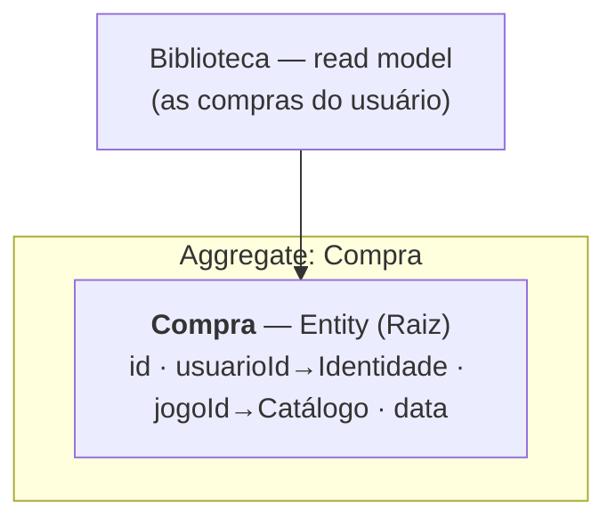

# DDD — Domínios, Context Map e Modelagem (PlayHub)

Aplicação do Domain-Driven Design ao PlayHub: identificação dos subdomínios, os
bounded contexts, o mapa de contextos e a modelagem (Entities, Value Objects e
Aggregates) de pelo menos um contexto.

---

## 1. Subdomínios

| Subdomínio | Tipo | Por quê |
|---|---|---|
| **Vendas** | Core (principal) | É o que gera valor: comprar jogos e montar a biblioteca |
| **Catálogo** | Supporting (apoio) | Cadastro e gestão dos jogos que serão vendidos |
| **Identidade & Acesso** | Generic (genérico) | Cadastro, login e permissões — padrão, não é o diferencial |

---

## 2. Bounded Contexts e Context Map

Cada subdomínio vira um **bounded context** com sua própria linguagem:

**Relações do mapa:**

- **Vendas → Catálogo** (Customer/Supplier): Vendas depende do Catálogo para
  saber preço e estoque do jogo. O Catálogo é o "fornecedor" do modelo de jogo.
- **Vendas → Identidade** e **Catálogo → Identidade**: ambos usam a identidade
  do usuário (quem compra / quem é admin). O `id` do usuário é a ligação
  compartilhada entre os contextos.

---

## 3. Modelagem do contexto **Catálogo**

Linguagem ubíqua: *Jogo*, *Preço*, *Estoque*, *Requisitos*, *Plataforma*.

- **Aggregate Root:** `Jogo` — é a raiz; qualquer alteração em preço, estoque ou
  requisitos passa por ele (mantém as invariantes).
- **Entity:** `Jogo` tem identidade própria (`id`) e ciclo de vida.
- **Value Objects:** `Preco`, `Estoque`, `Requisitos`, `Capa` — não têm
  identidade própria, valem pelo valor e são imutáveis (trocar o preço = novo
  `Preco`).
- **Invariantes (regras que o aggregate protege):**
  - `Preco.valor >= 0`;
  - `Estoque.quantidade >= 0`;
  - título e plataforma obrigatórios.

> No código atual, essas regras moram no `GameService`/`GameRepository`. A
> modelagem acima mostra como elas se organizam na linguagem do DDD.

---

## 4. Modelagem do contexto **Vendas** (resumo)

- **Aggregate Root:** `Compra` — registra que um usuário adquiriu um jogo.
- Referencia `Jogo` e `Usuário` **por id** (não "importa" o objeto inteiro dos
  outros contextos — cada contexto é dono do seu modelo).
- **Biblioteca:** visão (read model) das compras de um usuário.
- **Invariante:** só registra a compra se houver estoque (consultado no
  Catálogo); a baixa de estoque é feita de forma consistente.
