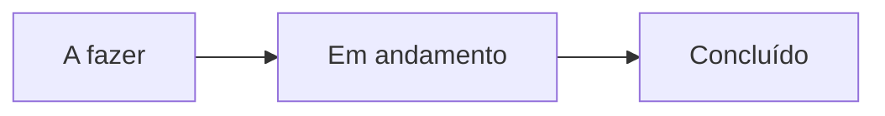

# Ciclo de Vida do Projeto — Abordagem Ágil (Scrum/Kanban)

Coerente com a análise Cynefin (domínio Complicado com partes Complexas),
conduzimos o PlayHub de forma **ágil**, com um Product Backlog no Jira e
entregas incrementais.

## 1. Product Backlog

O backlog vive no Jira (projeto **SCRUM**, keysforge.atlassian.net), organizado
em **Epics → Histórias/Tarefas**, priorizado e com status atualizado.

| Epic | Itens |
|---|---|
| **Catálogo de Jogos** (SCRUM-8) | CRUD de jogos, listar/buscar, página de detalhes |
| **Vendas e Biblioteca** (SCRUM-9) | comprar, biblioteca, lista de desejos |
| **Infraestrutura, Cache e Qualidade** (SCRUM-10) | Redis no Docker, cache-aside, Pub/Sub, CI/CD, correção de bug |

## 2. User Stories com critérios de aceite

As histórias seguem o formato padrão **"Como \<papel\>, quero \<objetivo\>, para
\<benefício\>"**, com critérios de aceite. Exemplo real (SCRUM-14):

> **Como** cliente, **quero** comprar um jogo, **para** adicioná-lo à minha biblioteca.
> **Critérios de aceite:**
> - a compra baixa o estoque de forma consistente;
> - não é possível comprar sem estoque;
> - após comprar, o jogo aparece na biblioteca.

## 3. Fluxo de trabalho (Kanban)

O quadro usa três colunas, tornando o progresso transparente:

Cada item caminha da esquerda para a direita conforme é desenvolvido e validado.

## 4. Papéis

Em um time pequeno/acadêmico, uma pessoa pode acumular papéis:

| Papel | Responsabilidade |
|---|---|
| **Product Owner** | prioriza o backlog e define os critérios de aceite |
| **Scrum Master / facilitador** | mantém o fluxo e remove impedimentos |
| **Dev(s)** | implementam, testam e entregam os itens |

## 5. Versões e lançamento de parciais

Entregamos o software em **incrementos versionados** (cada versão é uma parcial
utilizável):

| Versão | Entrega |
|---|---|
| **v0.1** | Autenticação + Catálogo (login/cadastro, CRUD de jogos, listagem) |
| **v0.2** | Vendas (compra, biblioteca, lista de desejos) |
| **v0.3** | Cache e mensageria (Redis), upload de imagens |
| **v0.4** | Pipeline CI/CD, documentação (OpenAPI, arquitetura) |

Cada versão passa pelos testes (automatizados no CI) antes de ser considerada
pronta — o que dá previsibilidade mesmo num fluxo iterativo.

## 6. Cadência (leve)

- **Planejamento:** escolher os próximos itens do backlog;
- **Execução:** mover itens no Kanban (A fazer → Em andamento → Concluído);
- **Revisão:** validar o incremento (testes verdes, feature demonstrável).

> Resumo: backlog priorizado no Jira + User Stories com critérios de aceite +
> fluxo Kanban + entregas versionadas = condução ágil do ciclo de vida.
